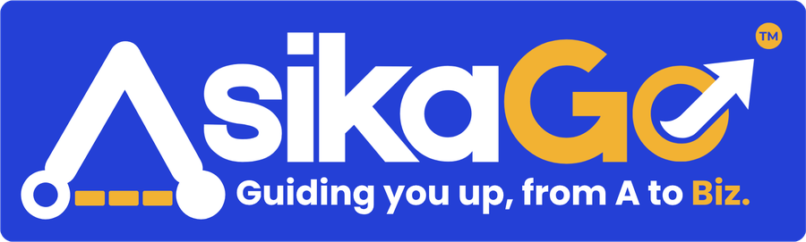
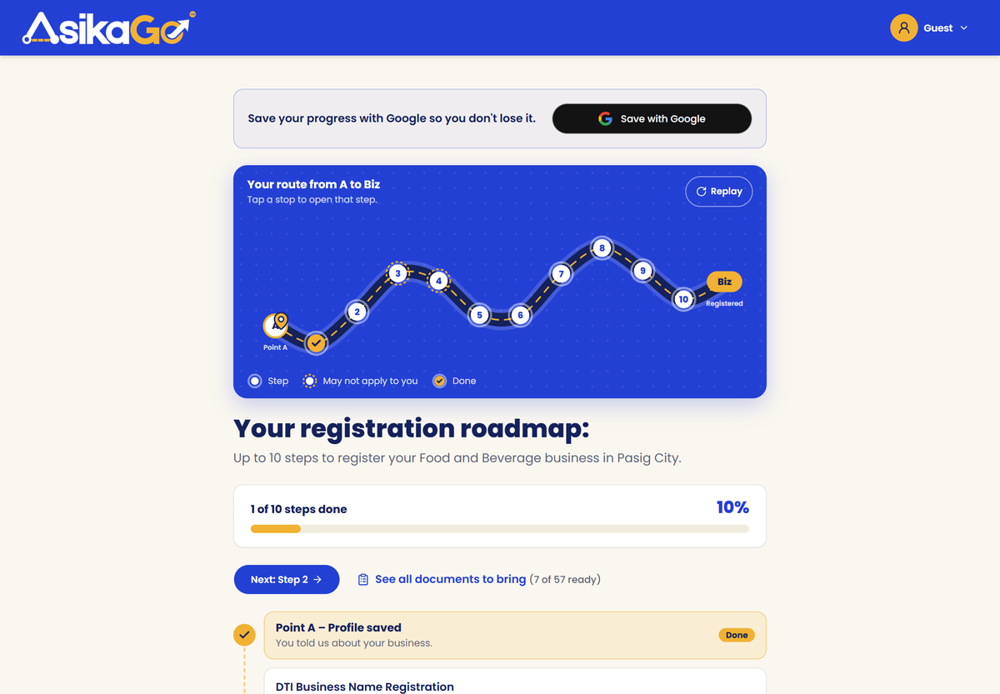
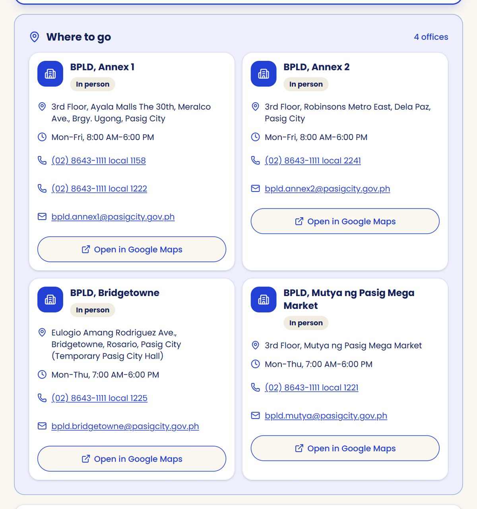
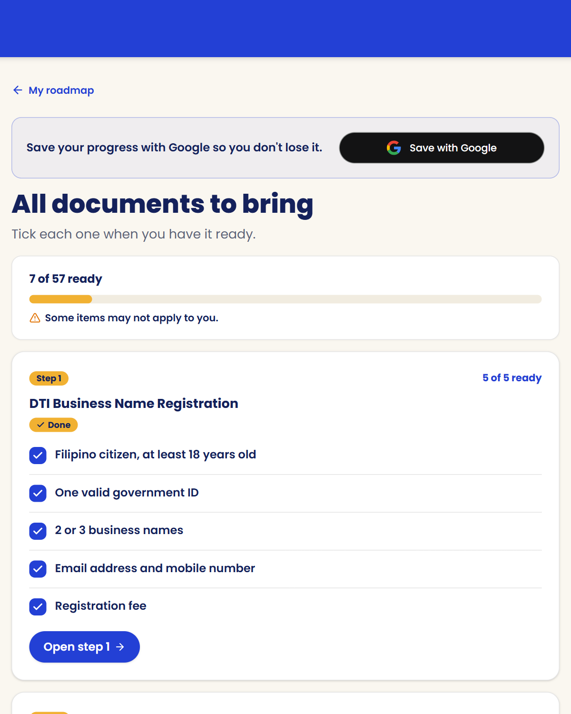
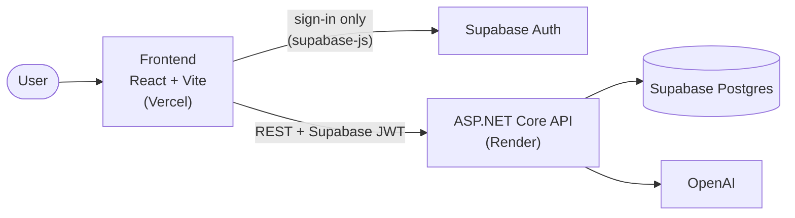

<div align="center">



<p><strong>A personalized, step-by-step roadmap for registering a small business in the Philippines.</strong></p>

[](https://github.com/HeyJudo/AsikaGo/actions/workflows/ci.yml)
[](https://asika-go.vercel.app)


[**Open the app**](https://asika-go.vercel.app) · [Docs](docs/) · [Decisions](docs/decisions.md) · [Getting started](#getting-started)

</div>

---

## Table of contents

- [About](#about)
- [Screenshots](#screenshots)
- [Features](#features)
- [Tech stack](#tech-stack)
- [Architecture](#architecture)
- [Getting started](#getting-started)
- [Everyday workflow](#everyday-workflow)
- [Project structure](#project-structure)
- [Deployment](#deployment)
- [Contributing](#contributing)
- [Documentation](#documentation)

## About

Registering a business in the Philippines means visiting several agencies (DTI or SEC, the barangay, City Hall, BIR) in the right order, with the right documents. Micro-entrepreneurs often learn the steps by trial and error.

AsikaGo asks a few questions about the business and builds a roadmap with only the steps and documents that apply to it. Users track their progress step by step until the business is registered.

**MVP scope:** Pasig City only. The schema keeps a `cities` table, so adding another LGU is seed data, not a code change ([D8](docs/decisions.md)).

## Screenshots

<table>
  <tr>
    <td width="50%"></td>
    <td width="50%"></td>
  </tr>
  <tr>
    <td align="center"><b>Your route from A to Biz</b><br/>Visual roadmap, progress and next step</td>
    <td align="center"><b>Where to go</b><br/>Offices for each step, with hours and contacts</td>
  </tr>
  <tr>
    <td width="50%"></td>
    <td></td>
  </tr>
  <tr>
    <td align="center"><b>All documents to bring</b><br/>One checklist across every step</td>
    <td></td>
  </tr>
</table>

## Features

**Available now**

- **Guest start, Google save.** Start as a guest with no sign-up. Link Google later and keep the same account and progress.
- **Business assessment.** Pick a business type and category. A "Not sure?" helper suggests a business type from simple questions.
- **Personalized roadmap.** A rules engine builds the step list for the business type, category and city. Steps that may not apply are marked, with the condition shown.
- **Step details.** What to do, which documents to bring, and which offices to visit, with address, hours, contacts and an embedded map.
- **Progress tracking.** Tick documents as ready, mark steps as done, and see the percentage and the next step.
- **Documents page.** Every document across the roadmap, grouped by step.

**In progress**

- **Describe your business (US-012).** Type a description in English, Tagalog or Taglish, and AI fills in the business type and category. API done (`POST /api/assessment/extract`). UI pending.
- **Registration assistant (US-013).** A chat that answers questions using only the user's roadmap. API done (`POST /api/assistant/ask`). UI pending.

The full backlog is in [`docs/AsikaGo_Product_Backlog_v1.1.md`](docs/AsikaGo_Product_Backlog_v1.1.md).

## Tech stack

| Part | Stack | Hosting |
|---|---|---|
| `frontend/` | React 19, Vite, TypeScript, Tailwind + shadcn/ui, TanStack Query, React Router | Vercel |
| `backend/` | ASP.NET Core (.NET 10) Minimal API, EF Core + Npgsql | Render (Docker) |
| Database / Auth | Supabase Postgres + Supabase Auth (Google, anonymous) | Supabase |
| AI | OpenAI Responses API (model set in `OpenAI:Model`) | OpenAI |
| CI | GitHub Actions: build, test, lint, API type check, DB migrations | GitHub |

## Architecture



- The frontend uses `supabase-js` **for auth only**. All data goes through the API.
- The API validates the Supabase JWT. Business logic lives in the backend.
- The roadmap engine is a plain class with no DB or HTTP code, so it is unit-tested directly.
- EF migrations own the schema. Knowledge-base data (steps, requirements, offices) is SQL in [`database/seed/`](database/seed/), applied through migrations.
- API types for the frontend are generated from the backend's OpenAPI document.

## Getting started

### Prerequisites

- [.NET 10 SDK](https://dotnet.microsoft.com/download)
- [Node.js 24](https://nodejs.org/)
- Access to the `asikago-dev` Supabase project (ask the team lead)

### Backend

```sh
cd backend
dotnet tool restore
dotnet user-secrets set "ConnectionStrings:Default" "Host=<pooler-host>;Port=5432;Database=postgres;Username=postgres.wlvkwumxktigpyzedcnq;Password=<db-password>;SSL Mode=Require" --project src/AsikaGo.Api
dotnet user-secrets set "OpenAI:ApiKey" "<key>" --project src/AsikaGo.Api
```

> [!IMPORTANT]
> Get `<pooler-host>` from Supabase → **Connect → Session pooler**. Use port **5432** (session pooler), not 6543. Get the OpenAI key from Jude privately. Never commit the password or the key, or paste them in the group chat.

### Frontend

```sh
cd frontend
npm install
cp .env.example .env.local   # then fill in the values
```

| Variable | Value |
|---|---|
| `VITE_SUPABASE_URL` | Supabase project URL |
| `VITE_SUPABASE_ANON_KEY` | The **anon public** key from Supabase → Project Settings → API Keys |
| `VITE_API_URL` | `http://localhost:5080` |

### Run

```sh
# terminal 1
cd backend && dotnet run --project src/AsikaGo.Api --urls http://localhost:5080

# terminal 2
cd frontend && npm run dev
```

Open http://localhost:5173. Start as a guest or sign in with Google, then take the assessment to get a roadmap.

## Everyday workflow

| Task | Command |
|---|---|
| Backend tests | `cd backend && dotnet test` |
| Frontend tests | `cd frontend && npm test` |
| Frontend lint / build | `cd frontend && npm run lint && npm run build` |
| Add a DB migration | `cd backend && dotnet ef migrations add <Name> --project src/AsikaGo.Api --output-dir Data/Migrations` |
| Apply migrations to the dev DB | Automatic. CI's `migrate-db` job applies them when the PR merges to `main`. Don't run `dotnet ef database update` by hand. |
| Regenerate API types after changing an endpoint | `cd backend && dotnet build`, then `cd frontend && npm run gen:api` |

> [!NOTE]
> CI fails if `backend/openapi/AsikaGo.Api.json` or `frontend/src/lib/api-types.ts` is stale. Commit both after changing an endpoint.

## Project structure

```text
AsikaGo/
├── backend/
│   ├── src/AsikaGo.Api/        # Minimal API, feature folders, EF Core
│   ├── tests/AsikaGo.Tests/    # Unit and API tests
│   └── openapi/                # Generated OpenAPI document
├── frontend/
│   ├── src/app/                # Router, layout, auth provider
│   ├── src/features/           # Feature folders
│   ├── src/components/         # Shared and shadcn/ui components
│   └── src/lib/                # API client, queries, generated API types
├── database/seed/              # Pasig knowledge base and offices (SQL)
└── docs/                       # PRD, backlog, architecture, research, QA cases
```

Features are vertical slices. One backlog story maps to one folder on each side:

| Feature | Backend `Features/` | Frontend `src/features/` |
|---|---|---|
| Sign-in and profile (US-003) | `Me/` | `auth/` |
| Assessment (US-001, 004, 012) | `Assessment/` | `assessment/` |
| Roadmap, steps, documents, progress, offices (US-005 to 009, 011, 014, 015) | `Roadmap/` | `roadmap/`, `progress/` |
| AI assistant (US-013) | `Assistant/` | `assistant/` (UI pending) |

## Deployment

| Part | Where | How |
|---|---|---|
| Frontend | [asika-go.vercel.app](https://asika-go.vercel.app) | Vercel deploys `frontend/` on every merge to `main`. |
| API | Render (Docker) | Render deploys after CI passes, so `migrate-db` updates the schema before the new API goes live. |
| Database | Supabase `asikago-dev` | One project serves local dev and the deployed app. |

Render's free tier sleeps after 15 minutes idle. [`keep-warm.yml`](.github/workflows/keep-warm.yml) pings `/health` every 10 minutes from 07:00 to 23:59 PH time. Before a demo, run it by hand from the **Actions** tab.

## Contributing

- `main` is protected. PRs need green CI and one review.
- Branch as `feature/123-short-name` (no `#` in branch names).
- Put the Azure Boards ticket in commit and PR messages as `AB#123`.
- Read [`docs/decisions.md`](docs/decisions.md) before changing code. It wins over every other doc.
- Building with AI? Follow [`docs/AI_Workflow.md`](docs/AI_Workflow.md).

## Documentation

| Doc | What's in it |
|---|---|
| [`decisions.md`](docs/decisions.md) | Architecture decisions and schema changes. Wins over every other doc. |
| [`AsikaGo_PRD_v1.0.md`](docs/AsikaGo_PRD_v1.0.md) | Product requirements |
| [`AsikaGo_Product_Backlog_v1.1.md`](docs/AsikaGo_Product_Backlog_v1.1.md) | User stories and priorities |
| [`AsikaGo_Technical_Architecture_v1.0.md`](docs/AsikaGo_Technical_Architecture_v1.0.md) | System architecture |
| [`AsikaGo_Database_Design_Specification_v1.0.md`](docs/AsikaGo_Database_Design_Specification_v1.0.md) | Database design |
| [`research/`](docs/research/) | Pasig registration workflow, requirements and offices |
| [`qa/`](docs/qa/) | Roadmap golden cases and AI test cases |

<div align="center">
<sub>Built by the AsikaGo team for Applications Development and Emerging Technologies.</sub>
</div>
